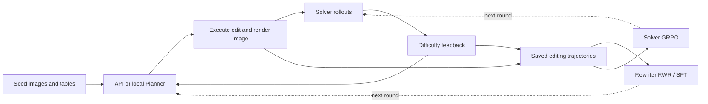

<h1 align="center">VICO</h1>
<p align="center"><b>Co-evolving visual environments, Rewriters, and Solvers</b></p>
<p align="center">
  <a href="https://arxiv.org/abs/2610.10782">Paper</a> ·
  <a href="#installation">Installation</a> ·
  <a href="docs/RUN_COMMANDS.md">Run commands</a> ·
  <a href="docs/DATA.md">Data</a> ·
  <a href="docs/VALIDATION.md">Validation</a>
</p>

VICO couples a visual editing Planner, an executable editor, and a Solver.
The Planner proposes changes, the editor renders new images and recomputes
answers, and Solver rollouts measure the difficulty of each edit. Saved
trajectories train the Rewriter with reward-weighted regression (RWR) and the
Solver with group relative policy optimization (GRPO). Supervised fine-tuning
(SFT) provides an optional Solver initialization.

This release organizes the original research implementations into generation,
evaluation, SFT, and RL modules. The included editor operates on CSV-backed
charts; another visual environment needs its own editor and answer rules.

## Contents

- [Method overview](#method-overview)
- [Repository structure](#repository-structure)
- [Installation](#installation)
- [Generation](#generation)
- [SFT training](#sft-training)
- [RL training](#rl-training)
- [Data and models](#data-and-models)
- [Validation](#validation)
- [Acknowledgments](#acknowledgments)

## Method overview



The API-Planner route has been exercised through generation, data construction,
and bounded training runs. The retained local Planner has source limitations;
a complete cycle replacing the API Planner with the newly trained Rewriter
remains unvalidated. See [validation details](docs/VALIDATION.md).

## Repository structure

```text
VICO/
├── vico/                       # Generation and evaluation
│   ├── run_evolution.py         # Planner → editor → Solver loop
│   ├── api_planner.py           # API Planner
│   ├── local_planner.py         # Local Rewriter inference
│   └── table_editor.py          # Table editing, rendering, answer extraction
│   
├── sft/                        # Supervised training
│   ├── generate_solver_sft.py   # Teacher-generated Solver reasoning
│   ├── build_solver_sft_data.py # Solver SFT data
│   ├── train_solver_sft.sh      # Solver LoRA SFT
│   ├── build_rewriter_data.py   # RWR-weighted Rewriter data
│   └── train_rewriter.sh        # Rewriter LoRA SFT
├── rl/                         # Reinforcement learning
│   ├── build_solver_data.py     # Trajectories → GRPO Parquet
│   ├── reward.py               # Original Solver reward and reward manager
│   └── train_solver.sh         # Solver GRPO with verl
├── docs/                       # Commands, data, validation, source provenance
├── requirements-data.txt       # Data and rendering dependencies
└── .env.example                # External API/model configuration
```

There are **13 core scripts**, with one implementation per stage. Training
engines are installed externally. [Source provenance](docs/SOURCE_PROVENANCE.json)
records the source and publication hashes of each selected implementation.

## Installation

```bash
git clone https://github.com/Lucanyc/VICO.git
cd VICO
pip install -r requirements-data.txt
```

Run the commands below from the repository root. GPU execution requires the
compatible Linux/CUDA research environments:

| Workflow | Required environment |
| --- | --- |
| Generation and evaluation | vLLM, Transformers, and their GPU dependencies |
| Solver GRPO | The compatible installed verl environment |
| Solver and Rewriter SFT | LLaMA-Factory with Qwen3-VL support |

[Observed package versions](docs/environment-reference.json) document the source
environment; they are a reference rather than a complete dependency lock.
`requirements-data.txt` installs data/rendering dependencies only. Supply models,
data, and API configuration externally; `.env.example` lists the variables and
must be loaded explicitly.

## Generation

Set `OPENAI_API_KEY`, `OPENAI_BASE_URL`, and `AMPLIFIER_MODEL` for your provider.
The same API configuration supplies the Planner and the editor's table changes.

```bash
CUDA_VISIBLE_DEVICES=0,1 python3 vico/run_evolution.py \
  --data_json /path/to/rewriter_seeds.json \
  --tables_dir /path/to/tables --png_dir /path/to/png \
  --start 0 --n 4 --model_path /path/to/solver \
  --planner_mode gpt5 --planner_model "$AMPLIFIER_MODEL" \
  --n_rollouts 8 --max_turns 5 \
  --output_dir outputs/images --output_json outputs/trajectories.json
```

Seed records need the original `tier` and `answer_cell` metadata. Saved
trajectories contain editing actions, generated image paths, recomputed answers,
and Solver feedback. [Run commands](docs/RUN_COMMANDS.md) give the full bounded
workflow and resume options.

## SFT training

### Solver initialization

Generate teacher reasoning with `sft/generate_solver_sft.py`, then convert the
saved records and launch LLaMA-Factory training:

```bash
python3 sft/build_solver_sft_data.py \
  --raw_files '/path/to/solver_sft_raw_*.json' \
  --output_dir outputs/solver_sft --min_think_words 200

BASE_MODEL=/path/to/base_model SFT_DATA_DIR="$PWD/outputs/solver_sft" \
LLAMA_FACTORY_DIR=/path/to/independent/LLaMA-Factory \
OUTPUT_DIR="$PWD/outputs/solver_adapter" GPUS=0,1,2,3 \
bash sft/train_solver_sft.sh
```

### Rewriter RWR

The data builder weights edits by `exp(-beta * (p_hat - 0.5)^2)` and uses
stochastic repetition to favor intermediate Solver difficulty.

```bash
python3 sft/build_rewriter_data.py \
  --traj_files outputs/trajectories.json --png_dir /path/to/png \
  --output_dir outputs/rewriter_data --beta 4.0 --max_repeats 5

ROUND=1 REWRITER_BASE=/path/to/previous_rewriter \
TRAIN_DATA="$PWD/outputs/rewriter_data/rewriter_rwr_train_llama.json" \
VAL_DATA="$PWD/outputs/rewriter_data/rewriter_rwr_val_llama.json" \
LLAMA_FACTORY_DIR=/path/to/independent/LLaMA-Factory \
OUTPUT_DIR="$PWD/outputs/rewriter_adapter" GPUS=0,1,2,3 \
bash sft/train_rewriter.sh
```

Both original SFT launchers write dataset registration and generated YAML into
LLaMA-Factory and may remove unreadable images from their input JSON. Use an
independent working copy and copied training inputs.

## RL training

The original GRPO builder retains valid edits regardless of their historical
Solver pass rate. `--n_original` controls additional original-example mixing.
For an exclusively rewritten pool, use the packaged-data adapter in
[data instructions](docs/DATA.md).

```bash
python3 rl/build_solver_data.py \
  --traj_files outputs/trajectories.json \
  --original_data /path/to/train_augmented.json --png_dir /path/to/png \
  --n_original 0 --output outputs/solver_grpo.parquet

ROUND=1 TRAIN_FILE="$PWD/outputs/solver_grpo.parquet" \
MODEL_PATH=/path/to/previous_solver CKPTS_DIR="$PWD/outputs/solver_ckpt" \
NUM_GPUS=8 TRAIN_BATCH_SIZE=32 TOTAL_EPOCHS=3 ROLLOUT_TEMPERATURE=0.7 \
bash rl/train_solver.sh
```

The launcher uses the active installed verl and loads `rl/reward.py` through
its custom-module loader, registering `vico_reward`. The original reward is
**+1** if the extracted answer is correct and all four thinking/answer tag
strings are present, and **-1** otherwise. Numeric answers follow the original
matching and near-zero rules.

The examples above start training with the source defaults. For the verified
two-step caps and resource overrides, use [bounded run commands](docs/RUN_COMMANDS.md).

## Data and models

Models and datasets are supplied separately. This code repository contains no
weights, training data, generated images, or raw experiment logs.

The separate rewritten archive has **41,495 QA records** and **41,481 generated
images** from 16 source runs, excluding original seed images. Its schema and
conversion instructions are in [data notes](docs/DATA.md). Rewriter training also
needs editing trajectories and the images originally shown to the Planner.

## Validation

The original reference experiment generated 17 valid edits from four seeds and
completed two Solver GRPO steps and two Rewriter SFT steps. Mean Solver rewards
were 0.5972 and 0.7014. These are bounded execution checks; they do not establish
benchmark improvements or a completed multi-round training run.

See [validation notes](docs/VALIDATION.md) for reward counts, parameter updates,
and limits. CI checks source syntax, all 23 original embedded reward cases, and
the 13 implementation hashes.

## Acknowledgments

Training builds on [verl](https://github.com/volcengine/verl) and
[LLaMA-Factory](https://github.com/hiyouga/LLaMA-Factory); inference uses
[vLLM](https://github.com/vllm-project/vllm). Repository organization follows the
generation/evaluation and SFT/RL presentation of
[PEDIA](https://github.com/antoinegg1/PEDIA).
